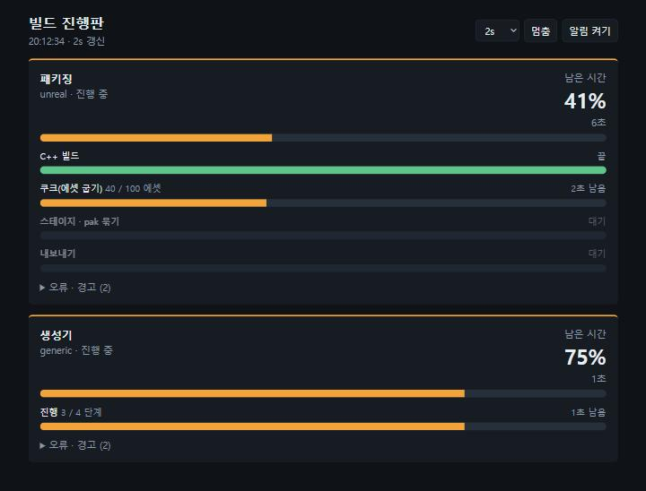

# EtaCast

빌드 · 패키징 · 긴 작업의 **단계별 진행 막대와 남은 시간**을 브라우저로 보는 작은 진행판.
표준 라이브러리만 쓴다 — 설치 없이 돌고, 게임 엔진이나 장르에 묶이지 않는다.



> **EtaCast** = ETA(남은 시간) + cast(여러 화면으로 내보냄). Python 3.10+ · MIT · Windows / macOS / Linux.

---

## 한국어

### 무엇을 하나
- 로그를 2초(0.5 · 1 · 2 · 5 · 10초, 또는 아무 값)마다 읽어 **단계**와 **진행률**을 본다.
- 남은 시간은 **지금 속도 → 지난 실행의 단계별 평균 → 이번 실행의 평균 속도** 순으로 셈한다. 기록이 없는 첫 실행은 "재는 중"이라고 쓴다(틀린 숫자를 먼저 보여 주지 않으려고).
- 오류 · 경고 줄을 모아 보여 준다. 끝 · 실패는 소리, 브라우저 알림, Discord · Slack 웹훅으로 알린다.
- 해석기는 **프로필**이다: 언리얼(UBT `[n/m]` · UAT 단계 · 쿠크) · 유니티 · 고도 · 범용(ninja/cmake · cargo · 퍼센트 줄) · 직접 쓰는 정규식.
- Claude와 연결: **MCP 서버**(`etacast_status` · `etacast_tail` · `etacast_start` · `etacast_wait`)와 **스킬**(`skills/etacast/SKILL.md`).

### 설치와 실행
```bash
git clone https://github.com/O3O-2022/EtaCast.git
cd EtaCast
python -m etacast watch --job "패키징=C:/logs/pkg.log:unreal" --port 8765
# → http://127.0.0.1:8765
```
명령을 감싸서 쓰면 출력도 같이 보여 준다:
```bash
python -m etacast run --name 패키징 --profile unreal -- python build.py
```
해석기 목록: `python -m etacast profiles`.

### 설정 파일 (`etacast.json`)
```json
{
  "title": "빌드 진행판",
  "interval": 2,
  "port": 8765,
  "jobs": [{ "name": "패키징", "log": "C:/logs/pkg.log", "profile": "unreal" }],
  "profiles": {
    "lua": {
      "name": "lua",
      "stages": [
        { "key": "bake", "name": "굽기", "weight": 2,
          "progress": [{ "kind": "ratio", "pattern": "(\\d+) of (\\d+)", "num": 1, "den": 2, "unit": "개" }] }
      ],
      "finish": ["ALL DONE"],
      "fail": ["FAILED"]
    }
  },
  "notify": { "webhook_url": "", "format": "discord" }
}
```
`--config etacast.toml`(Python 3.11+)도 된다. 단계의 `weight`는 전체에서 차지하는 몫이다(처음 실행의 어림용).

### 화면 옵션(주소 뒤에 붙인다)
- `?lang=ko` · `?lang=en` — 글 언어(생략하면 브라우저 언어)
- `?theme=dark` · `light` · `contrast`(고대비) — 색 테마
- `?accent=%23ff7a00` — 강조색
- `?sound=1` — 끝 · 실패 때 소리
- 갱신 주기 · 멈춤은 화면 위 단추로 바꾼다(주소 `/api/pause` · `/api/interval?sec=5`도 됨).

### Claude에 붙이기
```bash
claude mcp add etacast -- python -m etacast.mcp
```
그다음 Claude에게 "빌드 돌려 놓고 남은 시간 알려 줘"라고 하면 `etacast_start` → `etacast_wait`로 이어 쓴다.
스킬을 쓰려면 `skills/etacast/`를 `~/.claude/skills/`에 복사한다.

### 한계(정직하게)
- 고도 · 유니티 해석기의 줄 형식은 **실물 로그로 확인하지 않았다**. 막대가 0에 머물면 `etacast run`으로 감싸 종료 코드로 끝을 잡고, 정규식은 설정 파일에서 고친다.
- 로그 전체를 매번 읽는다. 수백 MB 로그면 주기를 5초 이상으로 둔다.
- 진행판 서버는 인증이 없다 — 기본값은 `127.0.0.1`(이 컴퓨터만). 바깥에 열지 않는다.

### 개발
```bash
python -m unittest discover -s tests -v
```

---

## English

EtaCast shows stage bars and time-left for builds, packaging and other long jobs in a browser board.
Standard library only, no install step, not tied to any engine or genre.

- Reads each log every 2 s (0.5 / 1 / 2 / 5 / 10 s, or any value); pause from the page or the API.
- Time-left uses, in order: the speed seen right now → the average duration of each stage across past runs (`~/.etacast/history.json`) → this run's average pace. A first run shows "measuring" instead of a guess.
- Collects error/warning lines; alerts on finish/failure with a sound, a browser notification, or a Discord/Slack webhook.
- Log readers are **profiles**: `unreal`, `unity`, `godot`, `generic` (ninja/cmake, cargo, percent lines), or your own regex profile in JSON.
- Claude hookup: an MCP server (`etacast_status`, `etacast_tail`, `etacast_start`, `etacast_wait`) and a Claude Code skill in `skills/etacast/`.

```bash
python -m etacast watch --job "build=C:/logs/build.log:unreal"   # open http://127.0.0.1:8765
python -m etacast run --name build -- make -j8                   # wrap a command
claude mcp add etacast -- python -m etacast.mcp                  # connect to Claude
```

Options in the page URL: `?lang=en|ko`, `?theme=dark|light|contrast`, `?accent=%23hex`, `?sound=1`.

Limits: the Unity and Godot readers are not yet checked against real logs; use `etacast run` to get the end from the exit code. The board has no authentication and binds to `127.0.0.1` by default.

License: MIT — see [LICENSE](LICENSE).
